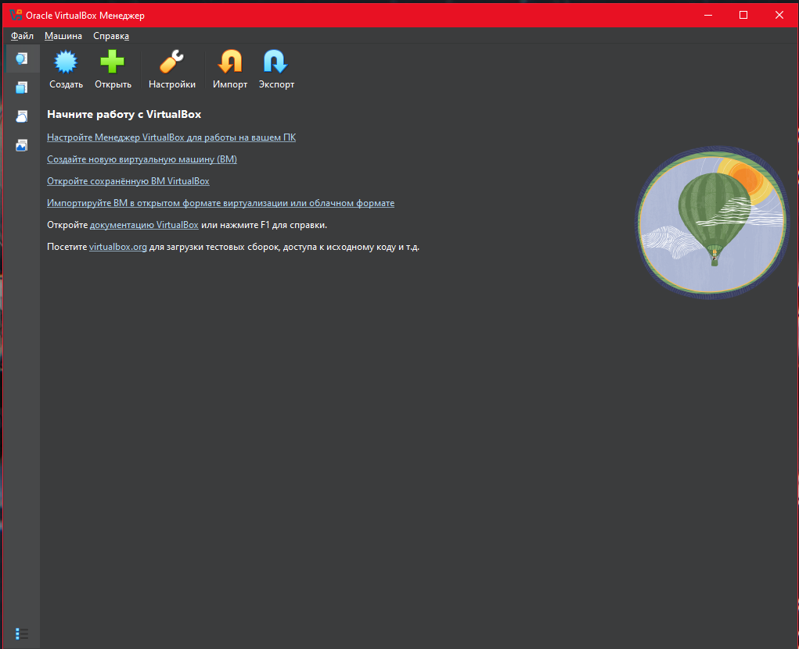

Методологии Dev-Ops
# Задание №1
**Дисциплина:** Основы методологии DevOps  
**Студент:** [Золотухин Александр Викторович]  
**Группа:** [3315д]  ]

## Цель работы
Приобрести практические навыки создания виртуальной машины, установки операционной системы Linux (Ubuntu) с использованием Oracle VM VirtualBox, а также настройки сетевого взаимодействия и проверки доступа в интернет.

## Теоретические сведения
**Виртуальная машина (ВМ)** — это программная система, которая эмулирует аппаратное обеспечение физического компьютера. 
**Oracle VM VirtualBox** — это бесплатный гипервизор (программа виртуализации) для создания и управления виртуальными машинами.
**Ubuntu** — это популярный дистрибутив операционной системы Linux, основанный на Debian, который широко используется в DevOps-практиках благодаря своей стабильности и поддержке серверных технологий.

## Ход выполнения

### 1. Создание виртуальной машины
Был запущен менеджер Oracle VM VirtualBox и нажата кнопка «Создать». 

В открывшемся окне были заданы следующие параметры:
- **Имя ВМ:** `vb1`
- **Образ ISO:** `ubuntu-22.04.5-desktop-amd64.iso`
- **Тип ОС:** Linux
- **Версия:** Ubuntu (64-bit)
*Галочка «Осуществить установку автоматически» была снята для ручной настройки процесса установки.*

На следующем этапе были выделены ресурсы для виртуального оборудования:
- **Оперативная память:** 2048 МБ (2 ГБ).
- **Процессоры:** 2.
- **Размер виртуального диска:** 51.78 ГБ.

Была проверена итоговая конфигурация ВМ и нажата кнопка «Готово».

### 2. Настройка сети
По умолчанию VirtualBox назначил виртуальной машине сетевой адаптер, работающий в режиме **NAT (Network Address Translation)**. Этот режим позволяет виртуальной машине использовать интернет-соединение хост-компьютера и получать доступ в глобальную сеть без сложной настройки.

### 3. Установка операционной системы Ubuntu
ВМ была запущена. В загрузочном меню GRUB был выбран пункт **«Try or Install Ubuntu»**.

Дождались загрузки установщика ОС Ubuntu.

**Параметры установки:**
1. **Язык интерфейса:** выбран English (по умолчанию).

   

2. **Раскладка клавиатуры:** выбрана English (US).

   

3. **Обновления и стороннее ПО:** выбрана «Normal installation» и опция загрузки обновлений во время установки.

   

4. **Тип установки:** выбран вариант **«Erase disk and install Ubuntu»** (стереть диск и установить Ubuntu), так как диск виртуальной машины пуст.

   

5. Подтверждено внесение изменений на диск.

   

6. **Часовой пояс:** выбран Krasnoyarsk.

   

7. **Создание пользователя:** задано имя пользователя `A`, имя компьютера `a-VirtualBox`, системный логин `a` и установлен пароль.

   

После завершения копирования файлов установщик предложил перезагрузить систему. Перезагрузка была выполнена.

### 4. Проверка доступа в интернет
После успешной загрузки установленной ОС и входа в систему был запущен веб-браузер Mozilla Firefox. В адресной строке был выполнен поисковый запрос «d». Страница успешно загрузилась, что подтверждает наличие доступа в интернет через настроенный сетевой адаптер.

